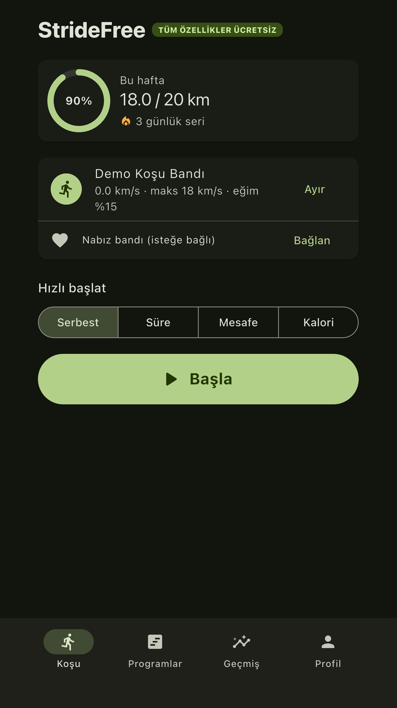
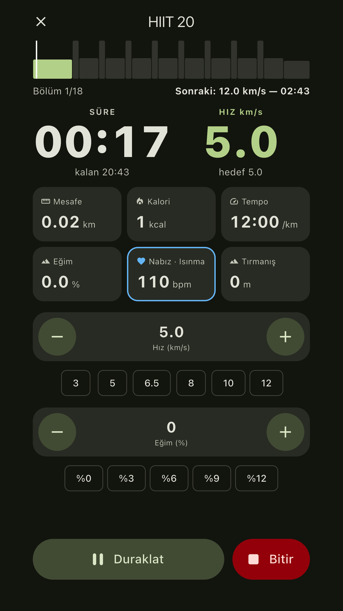
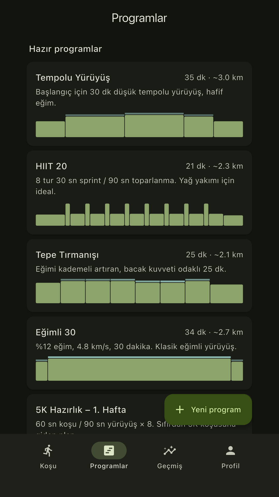
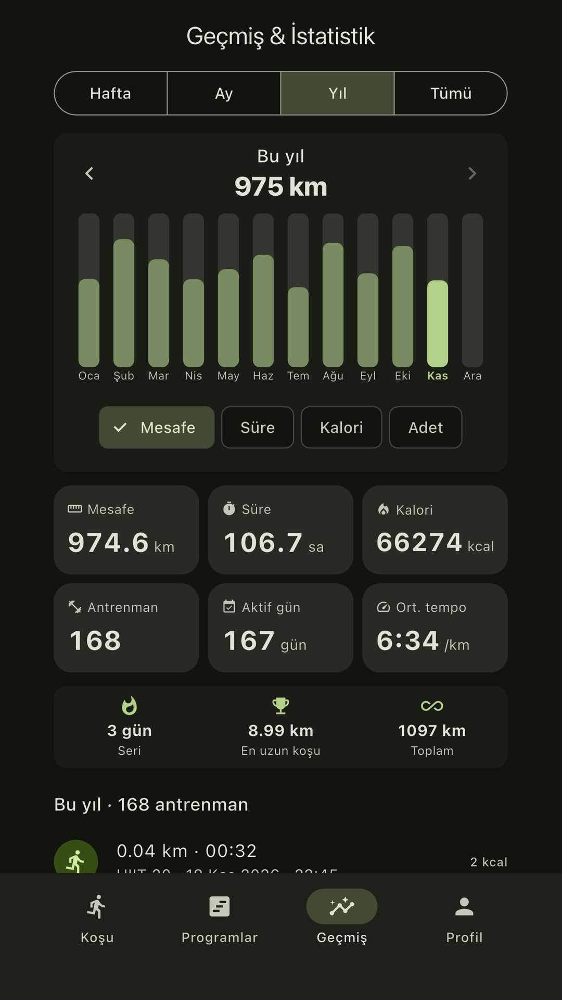
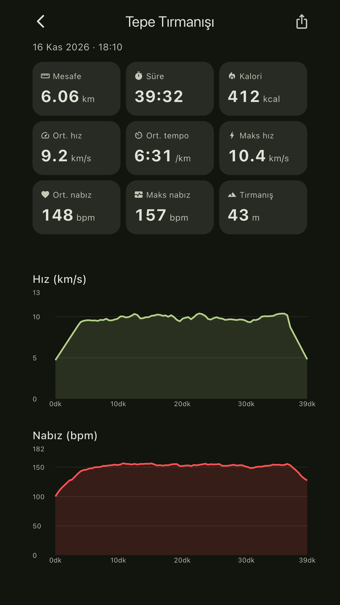

<div align="center">


# StrideFree

**The free, open-source treadmill app. No subscriptions. No ads. No paywalls.**

Control your Bluetooth treadmill from your phone, run interval programs, track heart rate,<br/>
and keep every workout — all on your device, all for free.

[](LICENSE)
[](https://flutter.dev)
[](#-platforms)
[](#-supported-treadmills)
[](#-contributing)
[](https://github.com/alisenn/stridefree/stargazers)

[Features](#-features) ·
[Supported treadmills](#-supported-treadmills) ·
[Get it](#-get-it) ·
[Build from source](#-build-from-source) ·
[FAQ](#-faq) ·
[**Türkçe**](README.tr.md)

<br/>







</div>

---

## 🤔 Why StrideFree?

Most treadmills ship with a companion app that locks programs, history or even basic speed control behind a monthly subscription — and uploads your workouts to someone else's server. StrideFree is the opposite.

|                                   | Typical treadmill app | **StrideFree** |
| --------------------------------- | :-------------------: | :------------: |
| Speed & incline control           |          ✅           |       ✅       |
| Interval / hill programs          |      💰 premium       |       ✅       |
| Unlimited custom programs         |      💰 premium       |       ✅       |
| Full workout history & charts     |      💰 premium       |       ✅       |
| Heart-rate strap support          |      💰 premium       |       ✅       |
| Export to Strava / Garmin (TCX)   |      💰 premium       |       ✅       |
| Ads                               |        often          |   **never**    |
| Account required                  |          yes          |   **no**       |
| Your data leaves the phone        |          yes          |   **never**    |
| Source code                       |        closed         |   **MIT**      |

## ✨ Features

**🏃 Treadmill control**
- Works with standard **Bluetooth FTMS** treadmills and the proprietary **FitShow** module protocol
- Speed & incline from your phone, one-tap presets, safety speed limit
- Reads the treadmill's own speed/incline limits automatically
- **Manual incline** support for treadmills with fold-out legs (e.g. 5 cm ≈ 5 %)
- Auto-pause and auto-reconnect if the Bluetooth link drops

**📋 Programs & goals**
- Built-in workouts: HIIT 20, Hill Climb, 5K Prep, Pyramid, Fat Burn, Incline 30, Tempo Walk
- Unlimited custom programs with a segment editor and one-tap interval blocks
- Speed and incline change automatically as the program runs
- Free run, or run to a **time**, **distance** or **calorie** goal

**❤️ Heart rate & calories**
- Any standard BLE heart-rate strap or watch that broadcasts HR
- 5 heart-rate zones based on your age
- Calories from the **ACSM metabolic equations** using your weight, speed and incline

**📊 History & stats**
- Weekly / monthly / yearly / all-time charts, streaks and personal records
- Speed and heart-rate graph for every workout
- Unlimited history — nothing is ever deleted unless you delete it

**🔁 Your data, your way**
- Import from **Strava**, **Apple Health**, **TCX**, **GPX** and **CSV** (duplicates are skipped)
- Export any workout as **TCX** to upload to Strava or Garmin Connect
- Full JSON backup & restore
- Crash-safe: an interrupted workout is recovered the next time you open the app

**🧪 Demo mode** — try every feature without a treadmill.

## 🏷 Supported treadmills

StrideFree talks to the treadmill directly over Bluetooth Low Energy.

| Protocol | Detected by | Notes |
| --- | --- | --- |
| **Bluetooth FTMS** (`0x1826`) | Service UUID | The open standard used by most modern treadmills |
| **FitShow** (`0xFFF0` / `0xFFE0`) | Service UUID or `FS-` name prefix | Common in budget treadmills without FTMS |

FTMS is tried first; you can prefer FitShow in **Profile**. Some FitShow modules report speed in miles — if speed looks 1.6× off, turn on *"Treadmill speed in miles"*.

### Tested devices

| Treadmill | Protocol | Status |
| --- | --- | --- |
| Relax RL-890 | FTMS | ✅ Speed, distance, calories · manual incline legs |
| *Your treadmill?* | | [Report it →](https://github.com/alisenn/stridefree/issues/new?title=Device%20report%3A%20&body=Brand%2Fmodel%3A%0AProtocol%20shown%20in%20app%3A%0AWhat%20works%3A%0AWhat%20doesn%27t%3A) |

> FitShow support is based on community-documented behaviour and has had limited testing on real hardware. If something is off on your treadmill, please open an issue with the brand and model — it's the most useful contribution you can make.

## 📲 Get it

| Platform | Status |
| --- | --- |
| **iOS** | In App Store review |
| **Android** | Google Play closed testing — public release soon |
| **Everything else** | [Build from source](#-build-from-source) |

⭐ **Star the repo** to get notified when it lands on the stores.

## 🛠 Build from source

Requires [Flutter](https://docs.flutter.dev/get-started/install) 3.x.

```bash
git clone https://github.com/alisenn/stridefree.git
cd stridefree
flutter pub get
flutter run              # connected phone or simulator
flutter run -d chrome    # web (Chrome / Edge — uses Web Bluetooth)
flutter test
```

### 💻 Platforms

Written in Flutter, so one codebase runs on **iOS, Android, macOS, Windows, Linux and Web**. Bluetooth works on mobile, desktop, and in Chromium-based browsers via Web Bluetooth.

<details>
<summary><b>Project structure</b></summary>

| Path | What's inside |
| --- | --- |
| `lib/devices.dart` | FTMS parser & driver, heart-rate strap, demo treadmill |
| `lib/fitshow.dart` | FitShow framing, status parser and driver |
| `lib/state.dart` | Settings, programs, history, device manager, workout engine |
| `lib/models.dart` | Data models (treadmill data, programs, sessions) |
| `lib/importer.dart` | Strava / Apple Health / TCX / GPX / CSV import, TCX export |
| `lib/stats.dart` | Period statistics, streaks, records |
| `lib/screens/` | UI: home, workout, programs, history, import, settings |
| `store/` | App Store / Play listing text, screenshots and helper scripts |

</details>

## 🔒 Privacy

StrideFree **collects nothing**. No accounts, no servers, no analytics, no ads, no tracking SDKs. Your profile, programs and workouts live only on your device and are gone when you delete the app. Bluetooth is used only to talk to your treadmill and heart-rate strap. Full policy: [PRIVACY.md](PRIVACY.md).

## ❓ FAQ

<details>
<summary><b>My treadmill shows different calories than the app. Which one is right?</b></summary>

Most treadmills don't know your weight and use a fixed default or a rough formula. StrideFree uses the ACSM walking/running equations with **your** weight (Profile), the live speed and the incline. If your weight is set correctly, the app's number is usually the more realistic one.
</details>

<details>
<summary><b>My treadmill has fold-out legs for incline. Does that count?</b></summary>

Yes. Turn on **Profile → Manual incline**, enter the percentage (rise ÷ length × 100, e.g. 5 cm over 100 cm = 5 %), and toggle *"Incline legs attached"* on the workout screen. Calories and elevation then use that incline.
</details>

<details>
<summary><b>Can I use my smartwatch as a heart-rate monitor?</b></summary>

If it can **broadcast heart rate over Bluetooth**, yes — Garmin, Polar, Coros, Suunto, most Amazfit and recent Xiaomi bands can. Enable HR broadcast on the watch, then tap *Heart-rate strap → Connect*.
</details>

<details>
<summary><b>Speed looks 1.6× too high or too low.</b></summary>

Your FitShow module reports miles. Turn on **Profile → Treadmill speed in miles**.
</details>

<details>
<summary><b>Which languages does the app support?</b></summary>

English and Turkish. The app follows your phone's language; you can switch it any time in **Profile → Language**. Want your language? Translations are welcome!
</details>

## 🗺 Roadmap

- [x] FTMS & FitShow control, programs, goals, history
- [x] Heart-rate straps, ACSM calories, manual incline
- [x] Strava / Apple Health / TCX / GPX / CSV import, TCX export
- [x] English & Turkish UI
- [ ] More languages
- [ ] Heart-rate–based calories and active vs. total calories
- [ ] Apple Health / Health Connect sync
- [ ] More real-world FitShow device testing
- [ ] Home-screen widgets & watch companion

Have an idea? [Open an issue](https://github.com/alisenn/stridefree/issues).

## 🤝 Contributing

Contributions of every size are welcome:

1. **Device reports** — tell us which treadmill you tested and what worked.
2. **Bug reports** — steps to reproduce plus brand/model if Bluetooth-related.
3. **Pull requests** — fork, create a branch, make sure `flutter analyze` and `flutter test` pass, open a PR.
4. **Translations** — help bring the app to your language.

## 📄 License

[MIT](LICENSE) © StrideFree contributors.

Bluetooth is provided by [flutter_blue_plus](https://pub.dev/packages/flutter_blue_plus), which is free for personal and non-profit use; commercial distribution needs its own license (see `kBleLicense` in `lib/devices.dart`).

FitShow is a trademark of its respective owner. StrideFree is not affiliated with FitShow; it is only compatible with FitShow-module treadmills.

---

<div align="center">

**If StrideFree saved you a subscription, consider giving it a ⭐ — it helps others find it.**

[](https://star-history.com/#alisenn/stridefree&Date)

</div>
