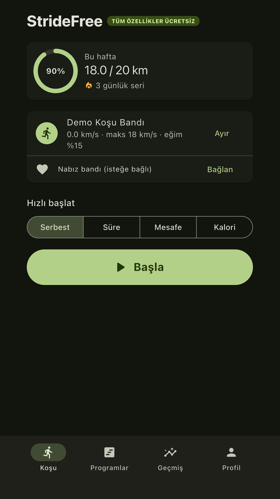
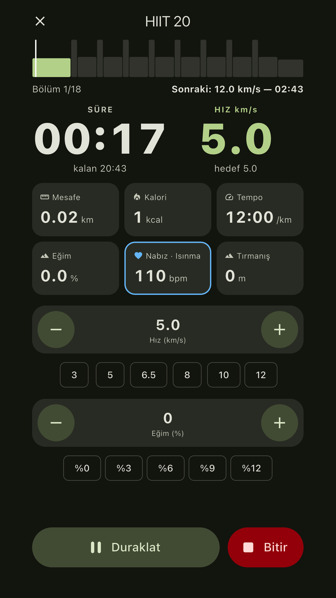
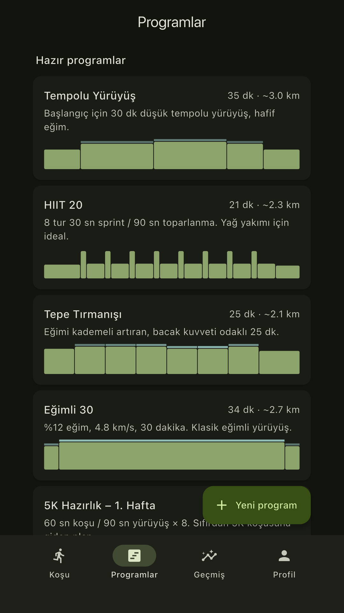
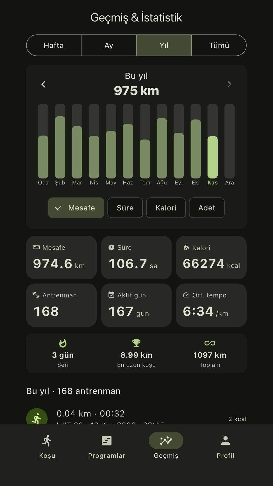
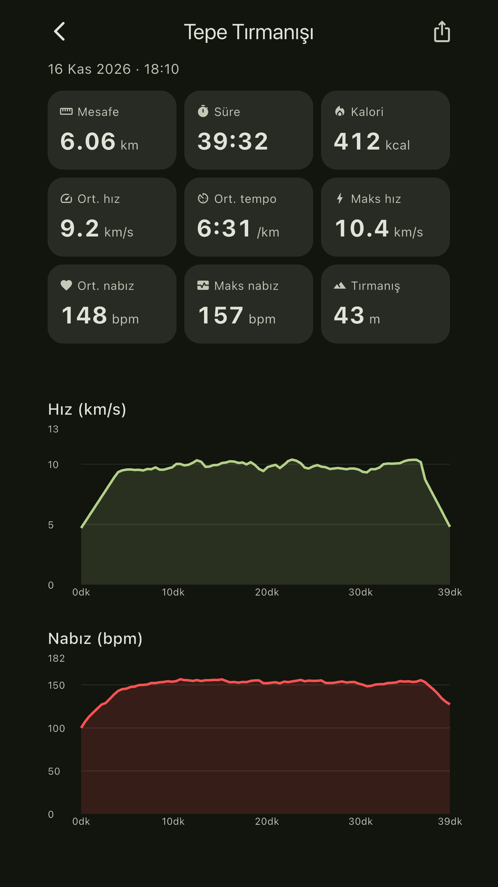

<div align="center">


# StrideFree

**Ücretsiz ve açık kaynak koşu bandı uygulaması. Abonelik yok. Reklam yok. Kilitli özellik yok.**

Bluetooth'lu koşu bandınızı telefondan yönetin, interval programları çalıştırın, nabzınızı takip edin<br/>
ve tüm antrenmanlarınızı saklayın — hepsi cihazınızda, hepsi ücretsiz.

[](LICENSE)
[](https://flutter.dev)
[](#-platformlar)
[](#-desteklenen-bantlar)
[](#-katk%C4%B1da-bulunun)
[](https://github.com/alisenn/stridefree/stargazers)

### [▶ Tarayıcıda deneyin](https://alisenn.github.io/stridefree/)
<sub>Sanal bant bağlamak için <b>Demo</b>'ya dokunun — cihaz gerekmez.</sub>

[Özellikler](#-özellikler) ·
[Desteklenen bantlar](#-desteklenen-bantlar) ·
[Mağazalar](#-mağazalar) ·
[Kaynaktan derle](#-kaynaktan-derleme) ·
[SSS](#-sık-sorulan-sorular) ·
[**English**](README.md)

<br/>







</div>

---

## 🤔 Neden StrideFree?

Koşu bantlarının çoğu, programları, geçmişi hatta basit hız kontrolünü bile aylık aboneliğe bağlayan ve antrenmanlarınızı başkasının sunucusuna gönderen bir uygulamayla gelir. StrideFree bunun tam tersi.

|                                   | Tipik bant uygulaması | **StrideFree** |
| --------------------------------- | :-------------------: | :------------: |
| Hız ve eğim kontrolü              |          ✅           |       ✅       |
| Interval / tepe programları       |      💰 premium       |       ✅       |
| Sınırsız özel program             |      💰 premium       |       ✅       |
| Tam geçmiş ve grafikler           |      💰 premium       |       ✅       |
| Nabız bandı desteği               |      💰 premium       |       ✅       |
| Strava / Garmin'e aktarma (TCX)   |      💰 premium       |       ✅       |
| Reklam                            |        çoğunlukla     |   **asla**     |
| Hesap zorunluluğu                 |          var          |   **yok**      |
| Verileriniz telefondan çıkar mı   |          evet         |   **asla**     |
| Kaynak kodu                       |         kapalı        |   **MIT**      |

## ✨ Özellikler

**🏃 Bant kontrolü**
- Standart **Bluetooth FTMS** bantlar ve **FitShow** modüllü bantlarla çalışır
- Hız ve eğimi telefondan ayarlayın, tek dokunuşla hazır değerler, güvenlik için hız sınırı
- Bandın hız/eğim limitlerini otomatik okur
- Ayaklı (manuel) eğimli bantlar için **manuel eğim** (ör. 5 cm ≈ %5)
- Bluetooth koparsa otomatik duraklatır ve yeniden bağlanır

**📋 Programlar ve hedefler**
- Hazır antrenmanlar: HIIT 20, Tepe Tırmanışı, 5K Hazırlık, Piramit, Yağ Yakım, Eğimli 30, Tempolu Yürüyüş
- Bölüm editörü ve tek tıkla interval bloklarıyla sınırsız özel program
- Program ilerledikçe hız ve eğim kendiliğinden değişir
- Serbest koşu ya da **süre**, **mesafe**, **kalori** hedefi

**❤️ Nabız ve kalori**
- Standart BLE nabız bandı ya da nabız yayını yapabilen akıllı saatler
- Yaşa göre 5 nabız bölgesi
- Kilonuz, hız ve eğimle **ACSM metabolik denklemlerine** göre kalori

**📊 Geçmiş ve istatistik**
- Haftalık / aylık / yıllık / tüm zamanlar grafikleri, seriler ve rekorlar
- Her antrenman için hız ve nabız grafiği
- Sınırsız geçmiş — siz silmedikçe hiçbir şey silinmez

**🔁 Verileriniz sizin**
- **Strava**, **Apple Sağlık**, **TCX**, **GPX** ve **CSV**'den içe aktarma (aynı antrenman iki kez eklenmez)
- Her antrenmanı **TCX** olarak dışa aktarıp Strava ya da Garmin Connect'e yükleyin
- Tüm verilerin JSON yedeği ve geri yüklemesi
- Uygulama kapansa bile yarım kalan antrenman bir sonraki açılışta kurtarılır

**🧪 Demo modu** — bant olmadan tüm özellikleri deneyin.

## 🏷 Desteklenen bantlar

| Protokol | Nasıl tanınır | Not |
| --- | --- | --- |
| **Bluetooth FTMS** (`0x1826`) | Servis UUID'si | Çoğu yeni bandın kullandığı açık standart |
| **FitShow** (`0xFFF0` / `0xFFE0`) | Servis UUID'si veya `FS-` ile başlayan ad | FTMS olmayan uygun fiyatlı bantlarda yaygın |

Önce FTMS denenir; **Profil**'den FitShow'u öncelikli yapabilirsiniz. Bazı FitShow modülleri hızı mil cinsinden bildirir — hız 1,6 kat farklı görünüyorsa *"Bant hızı mil cinsinden"* seçeneğini açın.

### Test edilmiş cihazlar

| Bant | Protokol | Durum |
| --- | --- | --- |
| Relax RL-890 | FTMS | ✅ Hız, mesafe, kalori · manuel eğim ayakları |
| *Sizin bandınız?* | | [Bildirin →](https://github.com/alisenn/stridefree/issues/new?template=device_report.yml) |

> FitShow desteği topluluğun belgelediği davranışa dayanır ve gerçek cihazlarda sınırlı test edildi. Bandınızda bir sorun varsa marka/modeliyle bir issue açın — yapabileceğiniz en değerli katkı bu.

## 📲 Mağazalar

| Platform | Durum |
| --- | --- |
| **iOS** | App Store incelemesinde |
| **Android** | Google Play kapalı testte — herkese açık sürüm yakında |
| **Web demo** | [alisenn.github.io/stridefree](https://alisenn.github.io/stridefree/) — Demo modu her tarayıcıda; gerçek bant Chrome / Edge'de Web Bluetooth ile |
| **Diğerleri** | [Kaynaktan derleyin](#-kaynaktan-derleme) |

⭐ Mağazalara çıktığında haberdar olmak için **repoya yıldız verin**.

## 🛠 Kaynaktan derleme

[Flutter](https://docs.flutter.dev/get-started/install) 3.x gerekir.

```bash
git clone https://github.com/alisenn/stridefree.git
cd stridefree
flutter pub get
flutter run              # bağlı telefon / simülatör
flutter run -d chrome    # web (Chrome / Edge — Web Bluetooth)
flutter test
```

### 💻 Platformlar

Flutter ile yazıldığı için tek kod tabanı **iOS, Android, macOS, Windows, Linux ve Web**'de çalışır. Bluetooth mobilde, masaüstünde ve Chromium tabanlı tarayıcılarda (Web Bluetooth) çalışır.

## 🔒 Gizlilik

StrideFree **hiçbir veri toplamaz**. Hesap, sunucu, analitik, reklam ya da takip aracı yoktur. Profiliniz, programlarınız ve antrenmanlarınız yalnızca cihazınızda saklanır, uygulamayı silince onlar da silinir. Bluetooth yalnızca bandınız ve nabız bandınızla konuşmak için kullanılır. Ayrıntılar: [PRIVACY.md](PRIVACY.md).

## ❓ Sık sorulan sorular

<details>
<summary><b>Bandın gösterdiği kalori ile uygulamanınki farklı. Hangisi doğru?</b></summary>

Çoğu bant kilonuzu bilmez; sabit bir varsayılan ya da kaba bir formül kullanır. StrideFree, **sizin** kilonuz (Profil), anlık hız ve eğimle ACSM yürüyüş/koşu denklemlerini kullanır. Kilonuz doğru girildiyse uygulamanın değeri genelde daha gerçekçidir.
</details>

<details>
<summary><b>Bandımın eğimi öndeki ayaklarla veriliyor. Bu da sayılıyor mu?</b></summary>

Evet. **Profil → Manuel eğim**'i açın, yüzdeyi girin (yükseklik farkı ÷ boy × 100, ör. 100 cm'de 5 cm = %5) ve antrenman ekranında *"Eğim ayakları takılı"* anahtarını açın. Kalori ve tırmanış bu eğimle hesaplanır.
</details>

<details>
<summary><b>Akıllı saatimi nabız bandı olarak kullanabilir miyim?</b></summary>

Saatiniz **nabzı Bluetooth üzerinden yayınlayabiliyorsa** evet — Garmin, Polar, Coros, Suunto, çoğu Amazfit ve yeni Xiaomi bantlar bunu yapabiliyor. Saatte nabız yayınını açın, ardından *Nabız bandı → Bağlan*'a dokunun.
</details>

<details>
<summary><b>Hız 1,6 kat fazla ya da az görünüyor.</b></summary>

FitShow modülünüz mil cinsinden bildiriyor. **Profil → Bant hızı mil cinsinden** seçeneğini açın.
</details>

## 🗺 Yol haritası

- [x] FTMS ve FitShow kontrolü, programlar, hedefler, geçmiş
- [x] Nabız bandı, ACSM kalori, manuel eğim
- [x] Strava / Apple Sağlık / TCX / GPX / CSV içe aktarma, TCX dışa aktarma
- [x] Türkçe ve İngilizce arayüz
- [ ] Diğer diller
- [ ] Nabza dayalı kalori, aktif / toplam kalori ayrımı
- [ ] Apple Sağlık / Health Connect senkronizasyonu
- [ ] Gerçek FitShow cihazlarında daha fazla test
- [ ] Ana ekran widget'ları ve saat uygulaması

Bir fikriniz mi var? [Issue açın](https://github.com/alisenn/stridefree/issues).

## 🤝 Katkıda bulunun

Her boyutta katkıya açığız — ayrıntılar [CONTRIBUTING.md](CONTRIBUTING.md) ve [Davranış Kuralları](CODE_OF_CONDUCT.md)'nda:

1. **Cihaz raporu** — hangi bandı denediğinizi ve neyin çalıştığını yazın.
2. **Hata bildirimi** — adımlar ve Bluetooth ile ilgiliyse marka/model.
3. **Pull request** — fork'layın, dal açın, `flutter analyze` ve `flutter test` geçsin, PR gönderin.
4. **Çeviri** — uygulamayı kendi dilinize taşımamıza yardım edin.

## 📄 Lisans

[MIT](LICENSE) © StrideFree katkıcıları.

Bluetooth için [flutter_blue_plus](https://pub.dev/packages/flutter_blue_plus) kullanılır; kişisel ve kâr amacı gütmeyen kullanımda ücretsizdir, ticari dağıtım ayrı lisans gerektirir (`lib/devices.dart` → `kBleLicense`).

FitShow, ilgili sahibinin markasıdır. StrideFree FitShow ile bağlantılı değildir; yalnızca FitShow modüllü bantlarla uyumludur.

---

<div align="center">

**StrideFree sizi bir abonelikten kurtardıysa ⭐ verin — başkalarının da bulmasına yardımcı olur.**

</div>
